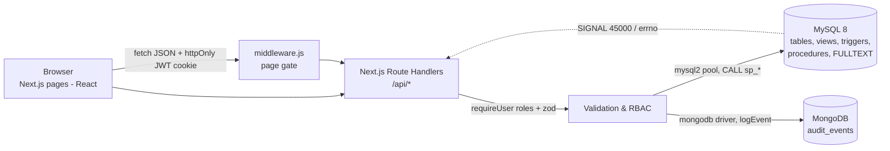

# System architecture

## Responsibilities
| Layer | Does | Does NOT |
|---|---|---|
| Browser | forms, tables, filters, dashboards | hold secrets |
| Route handlers | authenticate (JWT), authorise (role + participant checks), zod-validate, call procedures, write audit events, map DB errors to HTTP codes | contain business rules |
| MySQL | all business rules: m-of-n approval, state machine, single payout, immutability, disputes | |
| MongoDB | append-only audit trail + analytics | store money |

## Request example – "second signer approves"
1. `POST /api/escrows/7/approve` with cookie → `requireUser(['BUYER','SELLER','ARBITRATOR'])`.
2. `CALL sp_approve_escrow(7, userId, 'APPROVE', remarks)` → `START TRANSACTION`, `SELECT … FOR UPDATE` on the escrow row.
3. `INSERT approvals` → BEFORE trigger (still PENDING? before deadline?) → composite FK (is a signer?) → UNIQUE (one vote) → AFTER trigger counts approvals; threshold met ⇒ `UPDATE escrows SET status='APPROVED'` → state-machine trigger validates the transition.
4. `COMMIT`; API writes `APPROVAL_SUBMITTED` (+ `ESCROW_APPROVED`) to MongoDB and returns the new status.

## Configuration
All secrets via environment variables (`.env.local`): `MYSQL_*`, `MONGODB_URI`, `MONGODB_DB`, `JWT_SECRET`.
