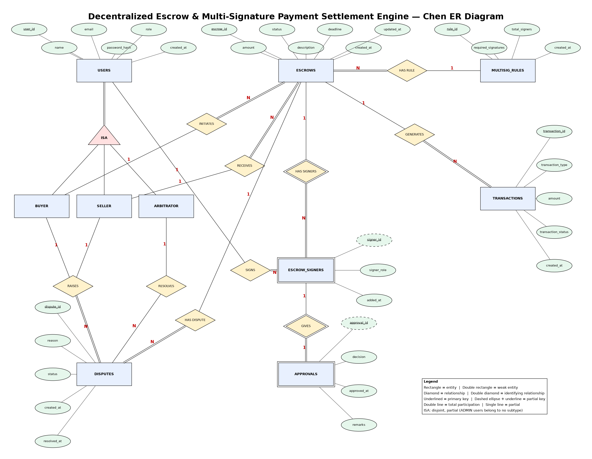

# Decentralized Escrow & Multi-Signature Payment Settlement Engine
**DBMS Experiential Learning – Level 3 Project** · Department of Computer Science and Engineering, PES University
Team: <Name 1 – SRN> · <Name 2 – SRN> · Section: <section> · Guide: Dr. Nagasundari S

---
## 1. Objectives
1. Model a trust-minimised payment flow in which funds are released only after an **m-of-n multi-signature** approval.
2. Push every business and integrity rule **into the database** (constraints, triggers, ACID procedures) so no client can violate it.
3. Combine a relational core (MySQL) with a document store (MongoDB) for an immutable, queryable audit trail.
4. Provide a role-based Next.js application (Buyer, Seller, Arbitrator, Admin) on top of that design.

## 2. Functional requirements
| ID | Requirement |
|---|---|
| FR1 | Users register/login; role-based access (BUYER, SELLER, ARBITRATOR, ADMIN) |
| FR2 | Buyer creates and funds an escrow, chooses seller, optional arbitrator and the m-of-n rule |
| FR3 | Signers approve or reject; once m approvals exist the escrow becomes APPROVED automatically |
| FR4 | Signer/admin releases approved funds exactly once; ledger records DEPOSIT/RELEASE/REFUND |
| FR5 | Buyer/seller raises a dispute; assigned arbitrator resolves (release, refund, dismiss) |
| FR6 | Overdue pending escrows are refunded and expired by an admin batch job |
| FR7 | Search/filter escrows and disputes (full-text); dashboards with analytics |
| FR8 | Every action is written to a MongoDB audit trail with per-escrow timeline and aggregated analytics |

## 3. ER diagram


Key modelling decisions: ISA (Buyer/Seller/Arbitrator) is *disjoint & partial* (Admin has no subtype);
ESCROW_SIGNERS is a weak entity of ESCROWS; APPROVALS is a weak entity of ESCROW_SIGNERS;
MULTISIG_RULES is a reusable template (ESCROWS N : 1 RULE); DISPUTES relate to ESCROWS, to the buyer/seller who raise them and to the arbitrator who resolves them.

## 4. Database choice and justification
| Data | Store | Justification |
|---|---|---|
| Users, escrows, signers, approvals, ledger, disputes | **MySQL (InnoDB)** | Strongly relational; money needs ACID transactions, row locks (`FOR UPDATE`), FKs and CHECK constraints; reporting needs JOIN/GROUP BY |
| Audit/event log | **MongoDB** | Heterogeneous, append-only, write-heavy documents; flexible `meta` per action; fast per-escrow timeline via compound index; aggregation pipeline for analytics; non-critical to payment correctness |
| Semantic/vector search | *not used* | No unstructured content where meaning-based retrieval adds value; MySQL FULLTEXT covers keyword search. Adding a vector DB would be technology for its own sake. |

## 5. Relational schema
 *(export the .drawio to PNG and embed it here)*

```
users(user_id PK, name, email UQ, password_hash, role, created_at)
multisig_rules(rule_id PK, required_signatures, total_signers, created_at, UQ(required_signatures,total_signers))
escrows(escrow_id PK, buyer_id FK→users, seller_id FK→users, rule_id FK→multisig_rules, amount, status, description, deadline, created_at, updated_at)
escrow_signers(signer_id PK, escrow_id FK→escrows, user_id FK→users, signer_role, added_at, UQ(escrow_id,user_id))
approvals(approval_id PK, escrow_id, user_id, decision, approved_at, remarks, UQ(escrow_id,user_id), FK(escrow_id,user_id)→escrow_signers)
transactions(transaction_id PK, escrow_id FK→escrows, transaction_type, amount, transaction_status, created_at)
disputes(dispute_id PK, escrow_id FK→escrows, raised_by FK→users, resolved_by FK→users NULL, reason, status, created_at, resolved_at)
```
**Normalisation:** all tables are in 3NF/BCNF – every non-key attribute depends on the key only; the m-of-n parameters are factored into `multisig_rules` instead of being repeated on every escrow; approvals and signers are separate because a signer exists before (and independently of) a vote.

## 6. Data dictionary
See [DATA_DICTIONARY.md](DATA_DICTIONARY.md).

## 7. Database implementation
### 7.1 SQL (MySQL 8) — files in `db/mysql/`
| Concept | Evidence |
|---|---|
| DDL CREATE/ALTER/DROP, PK/FK, constraints, indexes | `01_schema.sql`, `02_alter_drop.sql` |
| Views | `v_escrow_summary`, `v_pending_signatures`, `v_open_disputes`, `v_monthly_released` |
| **Transactions** | every `sp_*` procedure: `START TRANSACTION`, `SELECT … FOR UPDATE`, `EXIT HANDLER … ROLLBACK`, `COMMIT` |
| **Stored procedures / functions** | 6 procedures (one uses a **cursor**), 2 functions |
| **Triggers** | 9 triggers: m-of-n approval rule, state machine, single-payout ledger, immutability, dispute rules |
| **Indexing** | composite `(status, deadline)`, `(escrow_id, transaction_type)`, FK indexes; `EXPLAIN` in Q14 |
| **Full-text search** | `FULLTEXT(disputes.reason)`, `FULLTEXT(escrows.description)` + `MATCH … AGAINST` |

### 7.2 NoSQL (MongoDB) — see [MONGODB_DESIGN.md](MONGODB_DESIGN.md)
Collection `audit_events`, `$jsonSchema` validator, 3 indexes, 4 aggregation pipelines.

### 7.3 Data validation & integrity at the database level
ENUM domains, CHECK constraints (amount > 0, buyer ≠ seller, e-mail format, dispute state), UNIQUE (email, one vote per signer, one rule per m-of-n), composite FK (only registered signers vote), BEFORE triggers (deadline, status, party checks), immutable ledger, procedures raising `SIGNAL SQLSTATE '45000'` with explicit messages.
Consistency proof: test T38 (deposit = payout for every closed escrow) and T37 (view = base tables).

## 8. Important queries
See `db/mysql/07_queries.sql` (14 queries: JOIN, GROUP BY/HAVING, subquery, correlated NOT EXISTS, LEFT JOIN view, FULLTEXT ranking, window `RANK()`, UNION ALL, EXISTS, aggregates, EXPLAIN). Paste 3–4 outputs/screenshots here.

## 9. System architecture
See [ARCHITECTURE.md](ARCHITECTURE.md). Next.js 14 (App Router) → Route Handlers (JWT + RBAC + zod) → MySQL (`mysql2` pool, stored procedures) and MongoDB (audit). Secrets only in environment variables.

## 10. Application screenshots
*(insert: login, dashboard with filters, new escrow, escrow detail with progress bar & audit timeline, disputes with FTS, admin dashboard)*

## 11. Testing results
38 automated database tests (`npm run test:db`) + 12 manual UI/security cases – see `tests/TEST_CASES.md`. Paste the console output of `npm run test:db` here (expected: `38/38 passed`).

## 12. Conclusion
The project shows that correctness-critical logic (who may sign, when funds may move, and that they move only once) is best enforced where the data lives. MySQL provides atomicity and integrity; MongoDB supplies a flexible audit trail; Next.js exposes both through a role-based interface.
Possible extensions: real payment-gateway integration, signature cryptography, MySQL EVENT scheduler for expiry, vector search over dispute evidence.
